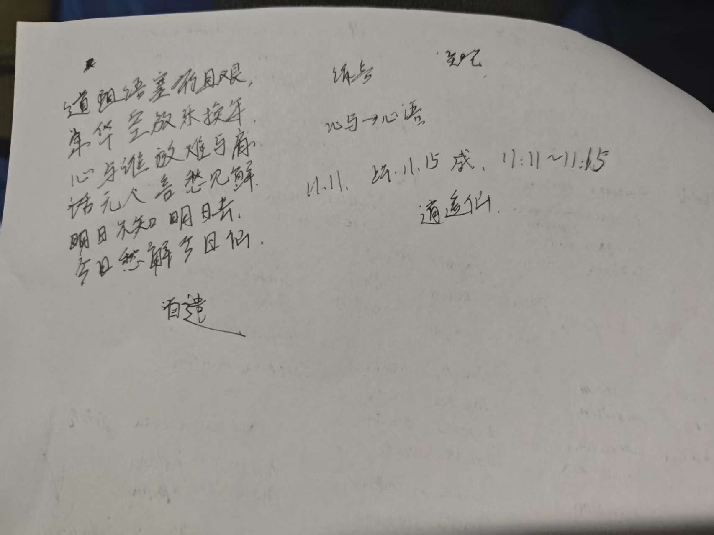

# 明日何往

**离非遇** · 2026 年 11 月 11 日 11:11—11:15（北京时间）

## 原诗

> 道阻语塞行且艰，  
> 年华空放乐换年。  
> 心有千言难尽诉，  
> 欲寻知己却无缘。  
> 明日不知明日去，  
> 今日忧释今日仙。

## 题解

此诗有感于年华易逝、世事多艰而作。

人生道路多有阻滞，纵有千言，亦难尽诉。人常为一时欢愉，舍长远之所求，以当下之安逸，易未来之可能。待岁月流转，方觉光阴虚度，而往事已不可追。

心中万绪，难寻知音；满腹言语，终无处倾诉。并非无话可说，只是知己难逢，心事难与人共担。

所谓明日，不过是昨日所期盼的今日。人总以为明日会有所不同，待明日真正到来，却又不知该往何处。昨日之忧未解，今日之愁又生，岁月更迭，而困惑依旧。

末句以仙为寄，非谓人间之忧皆可消解，亦非真有仙人能够释尽烦恼。只是凡人身处尘世，有些困惑终难自解，遂将超脱之愿寄于仙人。

全诗以时间为线，以自省为始，以孤独为境，以超脱为念。写年华之消耗、心事之无托，亦写对未来的期待与迷惘。

人生既不可追回昨日，亦无法预知明日。所求之答案，或许始终在路上。

## 手稿

